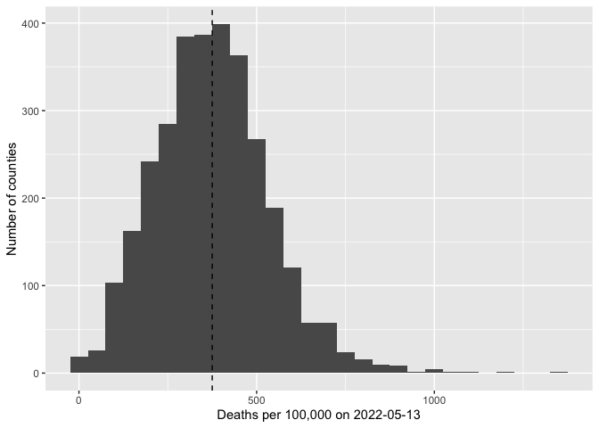
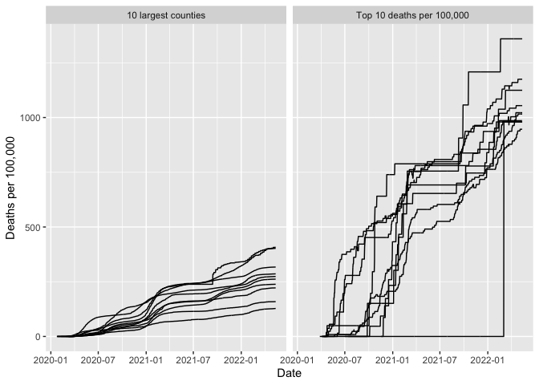
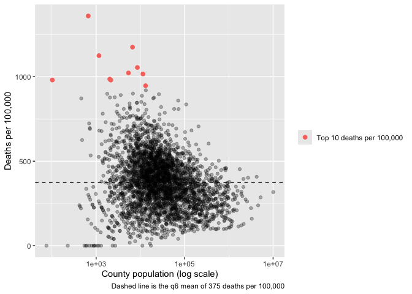
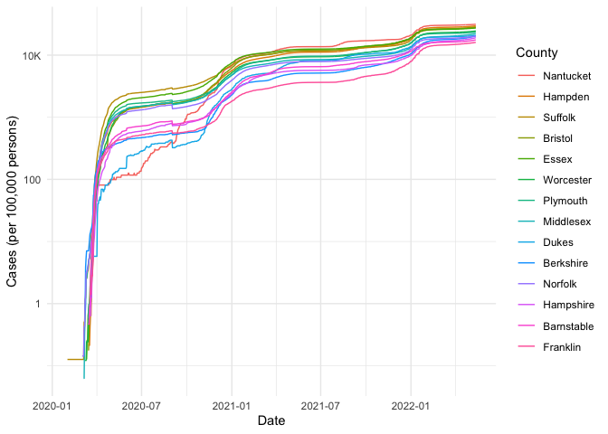

COVID-19
================
Hong Zhang
2026-10-14

- [Grading Rubric](#grading-rubric)
  - [Individual](#individual)
  - [Submission](#submission)
- [The Big Picture](#the-big-picture)
- [Get the Data](#get-the-data)
  - [Navigating the Census Bureau](#navigating-the-census-bureau)
    - [**q1** Load Table `B01003` into the following tibble. Make sure
      the column names are
      `id, Geographic Area Name, Estimate!!Total, Margin of Error!!Total`.](#q1-load-table-b01003-into-the-following-tibble-make-sure-the-column-names-are-id-geographic-area-name-estimatetotal-margin-of-errortotal)
  - [Automated Download of NYT Data](#automated-download-of-nyt-data)
    - [**q2** Visit the NYT GitHub repo and find the URL for the **raw**
      US County-level data. Assign that URL as a string to the variable
      below.](#q2-visit-the-nyt-github-repo-and-find-the-url-for-the-raw-us-county-level-data-assign-that-url-as-a-string-to-the-variable-below)
- [Join the Data](#join-the-data)
  - [**q3** Process the `id` column of `df_pop` to create a `fips`
    column.](#q3-process-the-id-column-of-df_pop-to-create-a-fips-column)
  - [**q4** Join `df_covid` with `df_q3` by the `fips` column. Use the
    proper type of join to preserve *only* the rows in
    `df_covid`.](#q4-join-df_covid-with-df_q3-by-the-fips-column-use-the-proper-type-of-join-to-preserve-only-the-rows-in-df_covid)
- [Analyze](#analyze)
  - [Normalize](#normalize)
    - [**q5** Use the `population` estimates in `df_data` to normalize
      `cases` and `deaths` to produce per 100,000 counts \[3\]. Store
      these values in the columns `cases_per100k` and
      `deaths_per100k`.](#q5-use-the-population-estimates-in-df_data-to-normalize-cases-and-deaths-to-produce-per-100000-counts-3-store-these-values-in-the-columns-cases_per100k-and-deaths_per100k)
  - [Guided EDA](#guided-eda)
    - [**q6** Compute some summaries](#q6-compute-some-summaries)
    - [**q7** Find and compare the top
      10](#q7-find-and-compare-the-top-10)
  - [Self-directed EDA](#self-directed-eda)
    - [**q8** Drive your own ship: You’ve just put together a very rich
      dataset; you now get to explore! Pick your own direction and
      generate at least one punchline figure to document an interesting
      finding. I give a couple tips & ideas
      below:](#q8-drive-your-own-ship-youve-just-put-together-a-very-rich-dataset-you-now-get-to-explore-pick-your-own-direction-and-generate-at-least-one-punchline-figure-to-document-an-interesting-finding-i-give-a-couple-tips--ideas-below)
    - [Ideas](#ideas)
    - [Aside: Some visualization
      tricks](#aside-some-visualization-tricks)
    - [Geographic exceptions](#geographic-exceptions)
- [Notes](#notes)

*Purpose*: In this challenge, you’ll learn how to navigate the U.S.
Census Bureau website, programmatically download data from the internet,
and perform a county-level population-weighted analysis of current
COVID-19 trends. This will give you the base for a very deep
investigation of COVID-19, which we’ll build upon for Project 1.

<!-- include-rubric -->

# Grading Rubric

<!-- -------------------------------------------------- -->

Unlike exercises, **challenges will be graded**. The following rubrics
define how you will be graded, both on an individual and team basis.

## Individual

<!-- ------------------------- -->

| Category | Needs Improvement | Satisfactory |
|----|----|----|
| Effort | Some task **q**’s left unattempted | All task **q**’s attempted |
| Observed | Did not document observations, or observations incorrect | Documented correct observations based on analysis |
| Supported | Some observations not clearly supported by analysis | All observations clearly supported by analysis (table, graph, etc.) |
| Assessed | Observations include claims not supported by the data, or reflect a level of certainty not warranted by the data | Observations are appropriately qualified by the quality & relevance of the data and (in)conclusiveness of the support |
| Specified | Uses the phrase “more data are necessary” without clarification | Any statement that “more data are necessary” specifies which *specific* data are needed to answer what *specific* question |
| Code Styled | Violations of the [style guide](https://style.tidyverse.org/) hinder readability | Code sufficiently close to the [style guide](https://style.tidyverse.org/) |

## Submission

<!-- ------------------------- -->

Make sure to commit both the challenge report (`report.md` file) and
supporting files (`report_files/` folder) when you are done! Then submit
a link to Canvas. **Your Challenge submission is not complete without
all files uploaded to GitHub.**

``` r
library(tidyverse)
```

    ## ── Attaching core tidyverse packages ──────────────────────── tidyverse 2.0.0 ──
    ## ✔ dplyr     1.2.1     ✔ readr     2.2.0
    ## ✔ forcats   1.0.1     ✔ stringr   1.6.0
    ## ✔ ggplot2   4.0.3     ✔ tibble    3.3.1
    ## ✔ lubridate 1.9.5     ✔ tidyr     1.3.2
    ## ✔ purrr     1.2.2     
    ## ── Conflicts ────────────────────────────────────────── tidyverse_conflicts() ──
    ## ✖ dplyr::filter() masks stats::filter()
    ## ✖ dplyr::lag()    masks stats::lag()
    ## ℹ Use the conflicted package (<http://conflicted.r-lib.org/>) to force all conflicts to become errors

*Background*:
[COVID-19](https://en.wikipedia.org/wiki/Coronavirus_disease_2019) is
the disease caused by the virus SARS-CoV-2. In 2020 it became a global
pandemic, leading to huge loss of life and tremendous disruption to
society. The New York Times (as of writing) publishes up-to-date data on
the progression of the pandemic across the United States—we will study
these data in this challenge.

*Optional Readings*: I’ve found this [ProPublica
piece](https://www.propublica.org/article/how-to-understand-covid-19-numbers)
on “How to understand COVID-19 numbers” to be very informative!

# The Big Picture

<!-- -------------------------------------------------- -->

We’re about to go through *a lot* of weird steps, so let’s first fix the
big picture firmly in mind:

We want to study COVID-19 in terms of data: both case counts (number of
infections) and deaths. We’re going to do a county-level analysis in
order to get a high-resolution view of the pandemic. Since US counties
can vary widely in terms of their population, we’ll need population
estimates in order to compute infection rates (think back to the
`Titanic` challenge).

That’s the high-level view; now let’s dig into the details.

# Get the Data

<!-- -------------------------------------------------- -->

1.  County-level population estimates (Census Bureau)
2.  County-level COVID-19 counts (New York Times)

## Navigating the Census Bureau

<!-- ------------------------- -->

**Steps**: Our objective is to find the 2018 American Community
Survey\[1\] (ACS) Total Population estimates, disaggregated by counties.
To check your results, this is Table `B01003`.

1.  Go to [data.census.gov](data.census.gov).
2.  Scroll down and click `View Tables`.
3.  Apply filters to find the ACS **Total Population** estimates,
    disaggregated by counties. I used the filters:

- `Topics > Populations and People > Counts, Estimates, and Projections > Population Total`
- `Geography > County > All counties in United States`

5.  Select the **Total Population** table and click the `Download`
    button to download the data; make sure to select the 2018 5-year
    estimates.
6.  Unzip and move the data to your `challenges/data` folder.

- Note that the data will have a crazy-long filename like
  `ACSDT5Y2018.B01003_data_with_overlays_2020-07-26T094857.csv`. That’s
  because metadata is stored in the filename, such as the year of the
  estimate (`Y2018`) and my access date (`2020-07-26`). **Your filename
  will vary based on when you download the data**, so make sure to copy
  the filename that corresponds to what you downloaded!

### **q1** Load Table `B01003` into the following tibble. Make sure the column names are `id, Geographic Area Name, Estimate!!Total, Margin of Error!!Total`.

*Hint*: You will need to use the `skip` keyword when loading these data!

``` r
## TASK: Load the census bureau data with the following tibble name.
# skip the row of census codes so the second row becomes the column names
# the file also has an empty last column so select() keeps only the four needed
df_pop <-
  read_csv("./data/ACSDT5Y2018.B01003-Data.csv", skip = 1) %>%
  select(
    id = Geography,
    `Geographic Area Name`,
    `Estimate!!Total`,
    `Margin of Error!!Total`
  )
```

    ## New names:
    ## Rows: 3220 Columns: 5
    ## ── Column specification
    ## ──────────────────────────────────────────────────────── Delimiter: "," chr
    ## (3): Geography, Geographic Area Name, Margin of Error!!Total dbl (1):
    ## Estimate!!Total lgl (1): ...5
    ## ℹ Use `spec()` to retrieve the full column specification for this data. ℹ
    ## Specify the column types or set `show_col_types = FALSE` to quiet this message.
    ## • `` -> `...5`

*Note*: You can find information on 1-year, 3-year, and 5-year estimates
[here](https://www.census.gov/programs-surveys/acs/guidance/estimates.html).
The punchline is that 5-year estimates are more reliable but less
current.

## Automated Download of NYT Data

<!-- ------------------------- -->

ACS 5-year estimates don’t change all that often, but the COVID-19 data
are changing rapidly. To that end, it would be nice to be able to
*programmatically* download the most recent data for analysis; that way
we can update our analysis whenever we want simply by re-running our
notebook. This next problem will have you set up such a pipeline.

The New York Times is publishing up-to-date data on COVID-19 on
[GitHub](https://github.com/nytimes/covid-19-data).

### **q2** Visit the NYT [GitHub](https://github.com/nytimes/covid-19-data) repo and find the URL for the **raw** US County-level data. Assign that URL as a string to the variable below.

``` r
## TASK: Find the URL for the NYT covid-19 county-level data
url_counties <-
  "https://raw.githubusercontent.com/nytimes/covid-19-data/master/us-counties.csv"
```

Once you have the url, the following code will download a local copy of
the data, then load the data into R.

``` r
## NOTE: No need to change this; just execute
## Set the filename of the data to download
filename_nyt <- "./data/nyt_counties.csv"

## Download the data locally
curl::curl_download(
        url_counties,
        destfile = filename_nyt
      )

## Loads the downloaded csv
df_covid <- read_csv(filename_nyt)
```

    ## Rows: 2502832 Columns: 6
    ## ── Column specification ────────────────────────────────────────────────────────
    ## Delimiter: ","
    ## chr  (3): county, state, fips
    ## dbl  (2): cases, deaths
    ## date (1): date
    ## 
    ## ℹ Use `spec()` to retrieve the full column specification for this data.
    ## ℹ Specify the column types or set `show_col_types = FALSE` to quiet this message.

You can now re-run the chunk above (or the entire notebook) to pull the
most recent version of the data. Thus you can periodically re-run this
notebook to check in on the pandemic as it evolves.

*Note*: You should feel free to copy-paste the code above for your own
future projects!

# Join the Data

<!-- -------------------------------------------------- -->

To get a sense of our task, let’s take a glimpse at our two data
sources.

``` r
## NOTE: No need to change this; just execute
df_pop %>% glimpse
```

    ## Rows: 3,220
    ## Columns: 4
    ## $ id                       <chr> "0500000US01001", "0500000US01003", "0500000U…
    ## $ `Geographic Area Name`   <chr> "Autauga County, Alabama", "Baldwin County, A…
    ## $ `Estimate!!Total`        <dbl> 55200, 208107, 25782, 22527, 57645, 10352, 20…
    ## $ `Margin of Error!!Total` <chr> "*****", "*****", "*****", "*****", "*****", …

``` r
df_covid %>% glimpse
```

    ## Rows: 2,502,832
    ## Columns: 6
    ## $ date   <date> 2020-01-21, 2020-01-22, 2020-01-23, 2020-01-24, 2020-01-24, 20…
    ## $ county <chr> "Snohomish", "Snohomish", "Snohomish", "Cook", "Snohomish", "Or…
    ## $ state  <chr> "Washington", "Washington", "Washington", "Illinois", "Washingt…
    ## $ fips   <chr> "53061", "53061", "53061", "17031", "53061", "06059", "17031", …
    ## $ cases  <dbl> 1, 1, 1, 1, 1, 1, 1, 1, 1, 1, 1, 1, 1, 1, 1, 1, 1, 1, 1, 1, 1, …
    ## $ deaths <dbl> 0, 0, 0, 0, 0, 0, 0, 0, 0, 0, 0, 0, 0, 0, 0, 0, 0, 0, 0, 0, 0, …

To join these datasets, we’ll need to use [FIPS county
codes](https://en.wikipedia.org/wiki/FIPS_county_code).\[2\] The last
`5` digits of the `id` column in `df_pop` is the FIPS county code, while
the NYT data `df_covid` already contains the `fips`.

### **q3** Process the `id` column of `df_pop` to create a `fips` column.

``` r
## TASK: Create a `fips` column by extracting the county code
# the fips code is everything after "US" in the id
df_q3 <-
  df_pop %>%
  mutate(fips = str_remove(id, ".*US"))
```

Use the following test to check your answer.

``` r
## NOTE: No need to change this
## Check known county
assertthat::assert_that(
              (df_q3 %>%
              filter(str_detect(`Geographic Area Name`, "Autauga County")) %>%
              pull(fips)) == "01001"
            )
```

    ## [1] TRUE

``` r
print("Very good!")
```

    ## [1] "Very good!"

### **q4** Join `df_covid` with `df_q3` by the `fips` column. Use the proper type of join to preserve *only* the rows in `df_covid`.

``` r
## TASK: Join df_covid and df_q3 by fips.
# left_join keeps every row of df_covid even if it has no population match
df_q4 <-
  df_covid %>%
  left_join(df_q3, by = "fips")
```

Use the following test to check your answer.

``` r
## NOTE: No need to change this
if (!any(df_q4 %>% pull(fips) %>% str_detect(., "02105"), na.rm = TRUE)) {
  assertthat::assert_that(TRUE)
} else {
  print(str_c(
    "Your df_q4 contains a row for the Hoonah-Angoon Census Area (AK),",
    "which is not in df_covid. You used the incorrect join type.",
    sep = " "
  ))
  assertthat::assert_that(FALSE)
}
```

    ## [1] TRUE

``` r
if (any(df_q4 %>% pull(fips) %>% str_detect(., "78010"), na.rm = TRUE)) {
  assertthat::assert_that(TRUE)
} else {
  print(str_c(
    "Your df_q4 does not include St. Croix, US Virgin Islands,",
    "which is in df_covid. You used the incorrect join type.",
    sep = " "
  ))
  assertthat::assert_that(FALSE)
}
```

    ## [1] TRUE

``` r
print("Very good!")
```

    ## [1] "Very good!"

For convenience, I down-select some columns and produce more convenient
column names.

``` r
## NOTE: No need to change; run this to produce a more convenient tibble
df_data <-
  df_q4 %>%
  select(
    date,
    county,
    state,
    fips,
    cases,
    deaths,
    population = `Estimate!!Total`
  )
```

# Analyze

<!-- -------------------------------------------------- -->

Now that we’ve done the hard work of loading and wrangling the data, we
can finally start our analysis. Our first step will be to produce county
population-normalized cases and death counts. Then we will explore the
data.

## Normalize

<!-- ------------------------- -->

### **q5** Use the `population` estimates in `df_data` to normalize `cases` and `deaths` to produce per 100,000 counts \[3\]. Store these values in the columns `cases_per100k` and `deaths_per100k`.

``` r
## TASK: Normalize cases and deaths
df_normalized <-
  df_data %>%
  mutate(
    cases_per100k = cases / population * 100000,
    deaths_per100k = deaths / population * 100000
  )
```

You may use the following test to check your work.

``` r
## NOTE: No need to change this
## Check known county data
if (any(df_normalized %>% pull(date) %>% str_detect(., "2020-01-21"))) {
  assertthat::assert_that(TRUE)
} else {
  print(str_c(
    "Date 2020-01-21 not found; did you download the historical data (correct),",
    "or just the most recent data (incorrect)?",
    sep = " "
  ))
  assertthat::assert_that(FALSE)
}
```

    ## [1] TRUE

``` r
if (any(df_normalized %>% pull(date) %>% str_detect(., "2022-05-13"))) {
  assertthat::assert_that(TRUE)
} else {
  print(str_c(
    "Date 2022-05-13 not found; did you download the historical data (correct),",
    "or a single year's data (incorrect)?",
    sep = " "
  ))
  assertthat::assert_that(FALSE)
}
```

    ## [1] TRUE

``` r
## Check datatypes
assertthat::assert_that(is.numeric(df_normalized$cases))
```

    ## [1] TRUE

``` r
assertthat::assert_that(is.numeric(df_normalized$deaths))
```

    ## [1] TRUE

``` r
assertthat::assert_that(is.numeric(df_normalized$population))
```

    ## [1] TRUE

``` r
assertthat::assert_that(is.numeric(df_normalized$cases_per100k))
```

    ## [1] TRUE

``` r
assertthat::assert_that(is.numeric(df_normalized$deaths_per100k))
```

    ## [1] TRUE

``` r
## Check that normalization is correct
assertthat::assert_that(
              abs(df_normalized %>%
               filter(
                 str_detect(county, "Snohomish"),
                 date == "2020-01-21"
               ) %>%
              pull(cases_per100k) - 0.127) < 1e-3
            )
```

    ## [1] TRUE

``` r
assertthat::assert_that(
              abs(df_normalized %>%
               filter(
                 str_detect(county, "Snohomish"),
                 date == "2020-01-21"
               ) %>%
              pull(deaths_per100k) - 0) < 1e-3
            )
```

    ## [1] TRUE

``` r
print("Excellent!")
```

    ## [1] "Excellent!"

## Guided EDA

<!-- ------------------------- -->

Before turning you loose, let’s complete a couple guided EDA tasks.

### **q6** Compute some summaries

Compute the mean and standard deviation for `cases_per100k` and
`deaths_per100k`. *Make sure to carefully choose **which rows** to
include in your summaries,* and justify why!

``` r
## TASK: Compute mean and sd for cases_per100k and deaths_per100k
# last date in the data
df_normalized %>%
  pull(date) %>%
  max()
```

    ## [1] "2022-05-13"

``` r
# keep only the last date since the counts are cumulative
# add the means as columns so q7 can compare each county to them
df_latest <-
  df_normalized %>%
  filter(
    date == max(date),
    !is.na(population)
  ) %>%
  mutate(
    cases_mean = mean(cases_per100k),
    deaths_mean = mean(deaths_per100k, na.rm = TRUE)
  )

df_latest %>%
  summarize(
    n_cases = n(),
    cases_mean = mean(cases_per100k),
    cases_sd = sd(cases_per100k),
    n_deaths = sum(!is.na(deaths_per100k)),
    deaths_mean = mean(deaths_per100k, na.rm = TRUE),
    deaths_sd = sd(deaths_per100k, na.rm = TRUE)
  )
```

    ## # A tibble: 1 × 6
    ##   n_cases cases_mean cases_sd n_deaths deaths_mean deaths_sd
    ##     <int>      <dbl>    <dbl>    <int>       <dbl>     <dbl>
    ## 1    3211     24774.    6233.     3133        375.      160.

- Which rows did you pick?
  - I picked only the rows from 2022-05-13, which is the last date in
    the data (printed at the top of the q6 chunk). I also dropped rows
    with no population estimate. That leaves 3211 counties for cases and
    3133 for deaths, shown in the n_cases and n_deaths columns of the
    summary table.
- Why?
  - The NYT GitHub page says each row is the cumulative number of cases
    and deaths up to that date. A county’s row on the last date already
    includes all of its earlier cases and deaths. Using every date would
    count each county once for every day it shows up and would pull the
    means down with early dates when the counts were close to zero.
  - Rows without a population estimate have NA for cases_per100k and
    deaths_per100k. These can’t go into a mean or sd. The geographic
    exceptions note below says New York City is one of these because it
    has no fips code.
  - There are 78 counties with a population estimate but no death count
    (3211 minus 3133). I used `na.rm = TRUE` to leave them out of the
    deaths mean and sd only.
  - Each county counts once no matter how many people live there. These
    means describe a typical county and not the rate for the whole
    country.

### **q7** Find and compare the top 10

Find the top 10 counties in terms of `cases_per100k`, and the top 10 in
terms of `deaths_per100k`. Report the population of each county along
with the per-100,000 counts. Compare the counts against the mean values
you found in q6. Note any observations.

``` r
## TASK: Find the top 10 max cases_per100k counties; report populations as well
# times_mean is how many times bigger than the q6 mean each county is
df_top_cases <-
  df_latest %>%
  arrange(desc(cases_per100k)) %>%
  mutate(times_mean = cases_per100k / cases_mean) %>%
  select(county, state, population, cases, cases_per100k, times_mean) %>%
  head(10)

df_top_cases
```

    ## # A tibble: 10 × 6
    ##    county                   state      population cases cases_per100k times_mean
    ##    <chr>                    <chr>           <dbl> <dbl>         <dbl>      <dbl>
    ##  1 Loving                   Texas             102   196       192157.       7.76
    ##  2 Chattahoochee            Georgia         10767  7486        69527.       2.81
    ##  3 Nome Census Area         Alaska           9925  6245        62922.       2.54
    ##  4 Northwest Arctic Borough Alaska           7734  4837        62542.       2.52
    ##  5 Crowley                  Colorado         5630  3347        59449.       2.40
    ##  6 Bethel Census Area       Alaska          18040 10362        57439.       2.32
    ##  7 Dewey                    South Dak…       5779  3139        54317.       2.19
    ##  8 Dimmit                   Texas           10663  5760        54019.       2.18
    ##  9 Jim Hogg                 Texas            5282  2648        50133.       2.02
    ## 10 Kusilvak Census Area     Alaska           8198  4084        49817.       2.01

``` r
## TASK: Find the top 10 deaths_per100k counties; report populations as well
df_top_deaths <-
  df_latest %>%
  arrange(desc(deaths_per100k)) %>%
  mutate(times_mean = deaths_per100k / deaths_mean) %>%
  select(county, state, population, deaths, deaths_per100k, times_mean) %>%
  head(10)

df_top_deaths
```

    ## # A tibble: 10 × 6
    ##    county            state        population deaths deaths_per100k times_mean
    ##    <chr>             <chr>             <dbl>  <dbl>          <dbl>      <dbl>
    ##  1 McMullen          Texas               662      9          1360.       3.62
    ##  2 Galax city        Virginia           6638     78          1175.       3.13
    ##  3 Motley            Texas              1156     13          1125.       3.00
    ##  4 Hancock           Georgia            8535     90          1054.       2.81
    ##  5 Emporia city      Virginia           5381     55          1022.       2.72
    ##  6 Towns             Georgia           11417    116          1016.       2.71
    ##  7 Jerauld           South Dakota       2029     20           986.       2.63
    ##  8 Loving            Texas               102      1           980.       2.61
    ##  9 Robertson         Kentucky           2143     21           980.       2.61
    ## 10 Martinsville city Virginia          13101    124           946.       2.52

**Observations**:

- Loving County, Texas has the highest cases per 100,000 at 192,157. The
  times_mean column shows this is about 7.8 times the q6 mean of 24,774.
  The other nine counties in the cases table are between 49,817 and
  69,527, which is about 2 to 2.8 times the mean.
- Loving County has 196 cases but a population estimate of only 102
  people. That is more cases than people. This could happen if the
  census estimate is too low or if some people were counted as cases
  more than once. The data here can’t show what caused it. I would not
  treat Loving County’s value as a real rate.
- The top 10 counties for deaths are between 946 and 1,360 deaths per
  100,000. The times_mean column shows these are about 2.5 to 3.6 times
  the q6 mean of 375.
- Every county in both tables has fewer than 20,000 people. The largest
  one is Bethel Census Area, Alaska with 18,040.
- With so few people, a small number of cases or deaths changes the rate
  a lot. Loving County is 8th in the deaths table with only 1 death.
- Loving County is the only county in both tables. Four of the top 10
  counties for cases are in Alaska. Three of the top 10 for deaths are
  Virginia cities (Galax, Emporia and Martinsville).
- When did these “largest values” occur?
  - On 2022-05-13, the last date in the data. The counts are cumulative
    and only add up over time, which puts each county’s largest value at
    the last date. That is why q7 can use `df_latest` from q6 directly.

**Comments for revision**

- I changed q6 to add the q6 means to `df_latest` as columns and changed
  q7 to sort `df_latest` instead of searching `df_normalized` for each
  county’s highest value. Since the counts are cumulative, the last date
  already has every county’s highest value. The top 10 counties and
  their values did not change. I also added a `times_mean` column so the
  comparison with the q6 mean is shown in the tables.

## Self-directed EDA

<!-- ------------------------- -->

### **q8** Drive your own ship: You’ve just put together a very rich dataset; you now get to explore! Pick your own direction and generate at least one punchline figure to document an interesting finding. I give a couple tips & ideas below:

### Ideas

<!-- ------------------------- -->

- Look for outliers.
- Try web searching for news stories in some of the outlier counties.
- Investigate relationships between county population and counts.
- Do a deep-dive on counties that are important to you (e.g. where you
  or your family live).
- Fix the *geographic exceptions* noted below to study New York City.
- Your own idea!

**DO YOUR OWN ANALYSIS HERE**

In q7 every county in the top 10 had fewer than 20,000 people. I wanted
to understand why the most extreme death rates come from such small
counties. I looked at this in three steps.

**Step 1: How do the top 10 compare with all counties?**

``` r
# dashed line is the q6 mean of 375 deaths per 100,000
df_latest %>%
  filter(!is.na(deaths_per100k)) %>%
  ggplot(aes(deaths_per100k)) +
  geom_histogram(binwidth = 50) +
  geom_vline(xintercept = 375, linetype = "dashed") +
  labs(
    x = "Deaths per 100,000 on 2022-05-13",
    y = "Number of counties"
  )
```

<!-- -->

*Observations*

- The histogram has one hill with the tallest bars right around the
  dashed mean line. Most counties are between about 100 and 700 deaths
  per 100,000.
- There is a long thin tail to the right that goes past 1000. The top 10
  counties from q7 (946 to 1,360) are all in this tail, where the bars
  are only a few counties tall.
- The short bar centered at 0 on the far left includes the counties that
  had no deaths at all.

**Step 2: How did the top 10 counties get so high?**

I compared the top 10 counties for deaths with the 10 largest counties
to see how deaths per 100,000 grew over time.

``` r
# the 10 counties with the most people that have a death count
df_largest <-
  df_latest %>%
  filter(!is.na(deaths_per100k)) %>%
  arrange(desc(population)) %>%
  head(10) %>%
  select(county, state)

df_normalized %>%
  semi_join(df_top_deaths, by = c("county", "state")) %>%
  mutate(group = "Top 10 deaths per 100,000") %>%
  bind_rows(
    df_normalized %>%
      semi_join(df_largest, by = c("county", "state")) %>%
      mutate(group = "10 largest counties")
  ) %>%
  ggplot(aes(date, deaths_per100k, group = county)) +
  geom_line() +
  facet_wrap(~group) +
  labs(
    x = "Date",
    y = "Deaths per 100,000"
  )
```

<!-- -->

*Observations*

- In the left panel, the lines for the 10 largest counties rise smoothly
  and all end below the 500 gridline.
- In the right panel, the lines for the top 10 counties go up in big
  steps instead of smoothly. In a small county each death moves the rate
  a lot. Even a few deaths in one week shows up as a jump.
- One line in the right panel stays at 0 until early 2022 and then jumps
  straight up to about 980. That is Loving County, where the q7 table
  shows 1 death out of 102 people. A single death took it from 0 to the
  8th highest rate in the country.

**Step 3 (punchline): Is the spread of death rates tied to county
size?**

This plot shows deaths per 100,000 against population for the 3133
counties with a death count on 2022-05-13 (n_deaths in q6). The red
points are the top 10 counties for deaths from q7.

``` r
# red points are the top 10 deaths counties from q7
df_latest %>%
  filter(!is.na(deaths_per100k)) %>%
  ggplot(aes(population, deaths_per100k)) +
  geom_point(alpha = 0.3) +
  geom_point(
    data = . %>% semi_join(df_top_deaths, by = c("county", "state")),
    mapping = aes(color = "Top 10 deaths per 100,000"),
    size = 2
  ) +
  geom_hline(yintercept = 375, linetype = "dashed") +
  scale_x_log10() +
  labs(
    x = "County population (log scale)",
    y = "Deaths per 100,000",
    color = "",
    caption = "Dashed line is the q6 mean of 375 deaths per 100,000"
  )
```

<!-- -->

**Observations**:

- The spread of the points gets smaller as population goes up. Counties
  left of the 1e+05 gridline go from 0 up to 1,360 deaths per 100,000
  (McMullen County in the q7 table). Every county right of the 1e+05
  gridline is above 0 and below the 1,000 gridline.
- All 10 red points are left of the 1e+05 gridline. So are all of the
  counties with 0 deaths.
- The red point farthest to the left is Loving County. With 102 people
  its 1 death puts it at 980 deaths per 100,000.
- This suggests the extreme values in q7 are partly because those
  counties are so small. In McMullen County, Texas, which has 662
  people, one death adds about 151 deaths per 100,000 while in a county
  right of the 1e+05 gridline one death adds less than 1.
- This plot can’t show why the red counties have such high rates. One
  possible reason is older residents, since older people were much more
  likely to die from COVID-19. To check this, I would need the median
  age of each county from the census (table B01002). That would show
  whether the red counties are older than the counties near the dashed
  line.

**Comments for revision**

- I added two explorations before the punchline plot. Step 1 looks at
  the distribution of death rates across all counties and Step 2
  compares how deaths per 100,000 grew over time in the top 10 counties
  and the 10 largest counties. Both led to the punchline plot in Step 3,
  which shows that the most extreme rates come from small counties.

### Aside: Some visualization tricks

<!-- ------------------------- -->

These data get a little busy, so it’s helpful to know a few `ggplot`
tricks to help with the visualization. Here’s an example focused on
Massachusetts.

``` r
## NOTE: No need to change this; just an example
df_normalized %>%
  filter(
    state == "Massachusetts", # Focus on Mass only
    !is.na(fips), # fct_reorder2 can choke with missing data
  ) %>%

  ggplot(
    aes(date, cases_per100k, color = fct_reorder2(county, date, cases_per100k))
  ) +
  geom_line() +
  # label_number_si() was removed from scales so this uses label_number()
  scale_y_log10(
    labels = scales::label_number(scale_cut = scales::cut_short_scale())
  ) +
  scale_color_discrete(name = "County") +
  theme_minimal() +
  labs(
    x = "Date",
    y = "Cases (per 100,000 persons)"
  )
```

<!-- -->

*Tricks*:

- I use `fct_reorder2` to *re-order* the color labels such that the
  color in the legend on the right is ordered the same as the vertical
  order of rightmost points on the curves. This makes it easier to
  reference the legend.
- I manually set the `name` of the color scale in order to avoid
  reporting the `fct_reorder2` call.
- I use `scales::label_number_si` to make the vertical labels more
  readable.
- I use `theme_minimal()` to clean up the theme a bit.
- I use `labs()` to give manual labels.

### Geographic exceptions

<!-- ------------------------- -->

The NYT repo documents some [geographic
exceptions](https://github.com/nytimes/covid-19-data#geographic-exceptions);
the data for New York, Kings, Queens, Bronx and Richmond counties are
consolidated under “New York City” *without* a fips code. Thus the
normalized counts in `df_normalized` are `NA`. To fix this, you would
need to merge the population data from the New York City counties, and
manually normalize the data.

# Notes

<!-- -------------------------------------------------- -->

\[1\] The census used to have many, many questions, but the ACS was
created in 2010 to remove some questions and shorten the census. You can
learn more in [this wonderful visual
history](https://pudding.cool/2020/03/census-history/) of the census.

\[2\] FIPS stands for [Federal Information Processing
Standards](https://en.wikipedia.org/wiki/Federal_Information_Processing_Standards);
these are computer standards issued by NIST for things such as
government data.

\[3\] Demographers often report statistics not in percentages (per 100
people), but rather in per 100,000 persons. This is [not always the
case](https://stats.stackexchange.com/questions/12810/why-do-demographers-give-rates-per-100-000-people)
though!
