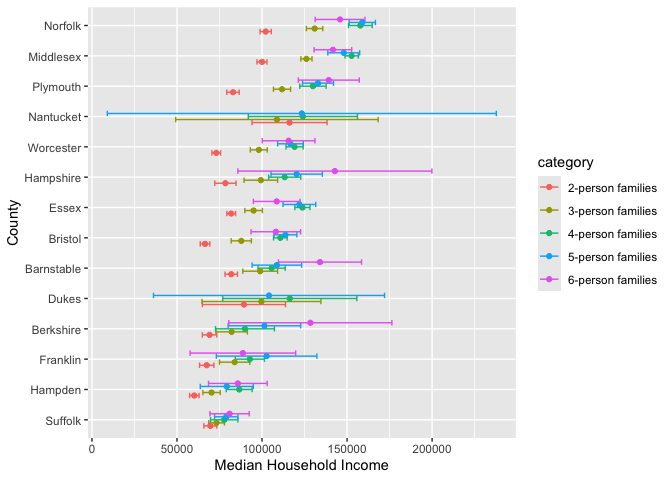
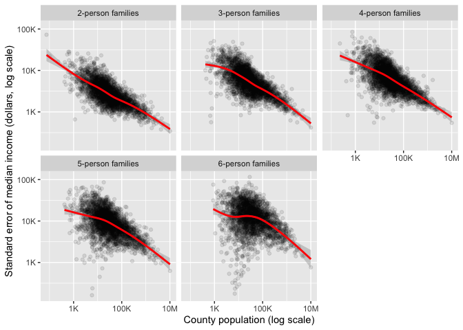
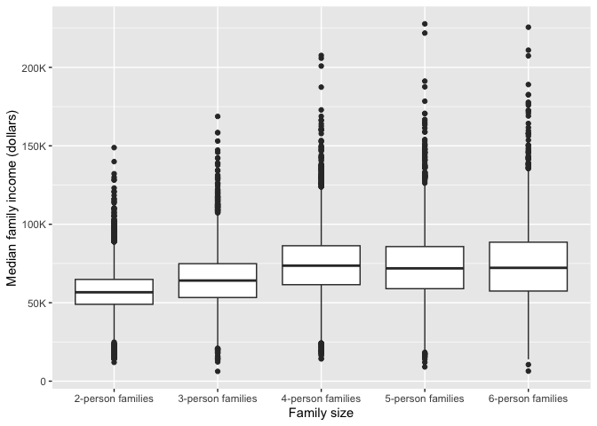

US Income
================
Hong Zhang
2026-11-05

- [Grading Rubric](#grading-rubric)
  - [Individual](#individual)
  - [Submission](#submission)
- [Setup](#setup)
  - [**q1** Load the population data from c06; simply replace
    `filename_pop`
    below.](#q1-load-the-population-data-from-c06-simply-replace-filename_pop-below)
  - [**q2** Obtain median income data from the Census
    Bureau:](#q2-obtain-median-income-data-from-the-census-bureau)
  - [**q3** Tidy the `df_income` dataset by completing the code below.
    Pivot and rename the columns to arrive at the column names
    `id, geographic_area_name, category, income_estimate, income_moe`.](#q3-tidy-the-df_income-dataset-by-completing-the-code-below-pivot-and-rename-the-columns-to-arrive-at-the-column-names-id-geographic_area_name-category-income_estimate-income_moe)
  - [**q4** Convert the margin of error to standard error. Additionally,
    compute a 99% confidence interval on income, and normalize the
    standard error to `income_CV = income_SE / income_estimate`. Provide
    these columns with the names
    `income_SE, income_lo, income_hi, income_CV`.](#q4-convert-the-margin-of-error-to-standard-error-additionally-compute-a-99-confidence-interval-on-income-and-normalize-the-standard-error-to-income_cv--income_se--income_estimate-provide-these-columns-with-the-names-income_se-income_lo-income_hi-income_cv)
  - [**q5** Join `df_q4` and `df_pop`.](#q5-join-df_q4-and-df_pop)
- [Analysis](#analysis)
  - [**q6** Study the following graph, making sure to note what you can
    *and can’t* conclude based on the estimates and confidence
    intervals. Document your observations below and answer the
    questions.](#q6-study-the-following-graph-making-sure-to-note-what-you-can-and-cant-conclude-based-on-the-estimates-and-confidence-intervals-document-your-observations-below-and-answer-the-questions)
  - [**q7** Plot the standard error against population for all counties.
    Create a visual that effectively highlights the trends in the data.
    Answer the questions under *observations*
    below.](#q7-plot-the-standard-error-against-population-for-all-counties-create-a-visual-that-effectively-highlights-the-trends-in-the-data-answer-the-questions-under-observations-below)
- [Going Further](#going-further)
  - [**q8** Pose your own question about the data. Create a
    visualization (or table) here, and document your
    observations.](#q8-pose-your-own-question-about-the-data-create-a-visualization-or-table-here-and-document-your-observations)
- [References](#references)

*Purpose*: We’ve been learning how to quantify uncertainty in estimates
through the exercises; now its time to put those skills to use studying
real data. In this challenge we’ll use concepts like confidence
intervals to help us make sense of census data.

*Reading*: - [Using ACS Estimates and Margin of
Error](https://www.census.gov/data/academy/webinars/2020/calculating-margins-of-error-acs.html)
(Optional, see the PDF on the page) - [Patterns and Causes of
Uncertainty in the American Community
Survey](https://www.sciencedirect.com/science/article/pii/S0143622813002518?casa_token=VddzQ1-spHMAAAAA:FTq92LXgiPVloJUVjnHs8Ma1HwvPigisAYtzfqaGbbRRwoknNq56Y2IzszmGgIGH4JAPzQN0)
(Optional, particularly the *Uncertainty in surveys* section under the
Introduction.)

<!-- include-rubric -->

# Grading Rubric

<!-- -------------------------------------------------- -->

Unlike exercises, **challenges will be graded**. The following rubrics
define how you will be graded, both on an individual and team basis.

## Individual

<!-- ------------------------- -->

| Category | Needs Improvement | Satisfactory |
|----|----|----|
| Effort | Some task **q**’s left unattempted | All task **q**’s attempted |
| Observed | Did not document observations, or observations incorrect | Documented correct observations based on analysis |
| Supported | Some observations not clearly supported by analysis | All observations clearly supported by analysis (table, graph, etc.) |
| Assessed | Observations include claims not supported by the data, or reflect a level of certainty not warranted by the data | Observations are appropriately qualified by the quality & relevance of the data and (in)conclusiveness of the support |
| Specified | Uses the phrase “more data are necessary” without clarification | Any statement that “more data are necessary” specifies which *specific* data are needed to answer what *specific* question |
| Code Styled | Violations of the [style guide](https://style.tidyverse.org/) hinder readability | Code sufficiently close to the [style guide](https://style.tidyverse.org/) |

## Submission

<!-- ------------------------- -->

Make sure to commit both the challenge report (`report.md` file) and
supporting files (`report_files/` folder) when you are done! Then submit
a link to Canvas. **Your Challenge submission is not complete without
all files uploaded to GitHub.**

# Setup

<!-- ----------------------------------------------------------------------- -->

``` r
library(tidyverse)
```

    ## ── Attaching core tidyverse packages ──────────────────────── tidyverse 2.0.0 ──
    ## ✔ dplyr     1.2.1     ✔ readr     2.2.0
    ## ✔ forcats   1.0.1     ✔ stringr   1.6.0
    ## ✔ ggplot2   4.0.3     ✔ tibble    3.3.1
    ## ✔ lubridate 1.9.5     ✔ tidyr     1.3.2
    ## ✔ purrr     1.2.2     
    ## ── Conflicts ────────────────────────────────────────── tidyverse_conflicts() ──
    ## ✖ dplyr::filter() masks stats::filter()
    ## ✖ dplyr::lag()    masks stats::lag()
    ## ℹ Use the conflicted package (<http://conflicted.r-lib.org/>) to force all conflicts to become errors

### **q1** Load the population data from c06; simply replace `filename_pop` below.

``` r
## TODO: Give the filename for your copy of Table B01003
filename_pop <- "./data/ACSDT5Y2018.B01003-Data.csv"

## NOTE: No need to edit
df_pop <-
  read_csv(
    filename_pop,
    skip = 1,
  ) %>% 
  rename(
    population_estimate = `Estimate!!Total`
  )
```

    ## New names:
    ## Rows: 3220 Columns: 5
    ## ── Column specification
    ## ──────────────────────────────────────────────────────── Delimiter: "," chr
    ## (3): Geography, Geographic Area Name, Margin of Error!!Total dbl (1):
    ## Estimate!!Total lgl (1): ...5
    ## ℹ Use `spec()` to retrieve the full column specification for this data. ℹ
    ## Specify the column types or set `show_col_types = FALSE` to quiet this message.
    ## • `` -> `...5`

``` r
df_pop
```

    ## # A tibble: 3,220 × 5
    ##    Geography   `Geographic Area Name` population_estimate Margin of Error!!Tot…¹
    ##    <chr>       <chr>                                <dbl> <chr>                 
    ##  1 0500000US0… Autauga County, Alaba…               55200 *****                 
    ##  2 0500000US0… Baldwin County, Alaba…              208107 *****                 
    ##  3 0500000US0… Barbour County, Alaba…               25782 *****                 
    ##  4 0500000US0… Bibb County, Alabama                 22527 *****                 
    ##  5 0500000US0… Blount County, Alabama               57645 *****                 
    ##  6 0500000US0… Bullock County, Alaba…               10352 *****                 
    ##  7 0500000US0… Butler County, Alabama               20025 *****                 
    ##  8 0500000US0… Calhoun County, Alaba…              115098 *****                 
    ##  9 0500000US0… Chambers County, Alab…               33826 *****                 
    ## 10 0500000US0… Cherokee County, Alab…               25853 *****                 
    ## # ℹ 3,210 more rows
    ## # ℹ abbreviated name: ¹​`Margin of Error!!Total`
    ## # ℹ 1 more variable: ...5 <lgl>

You might wonder why the `Margin of Error` in the population estimates
is listed as `*****`. From the [documentation (PDF
link)](https://www.google.com/url?sa=t&rct=j&q=&esrc=s&source=web&cd=&cad=rja&uact=8&ved=2ahUKEwj81Omy16TrAhXsguAKHTzKDQEQFjABegQIBxAB&url=https%3A%2F%2Fwww2.census.gov%2Fprograms-surveys%2Facs%2Ftech_docs%2Faccuracy%2FMultiyearACSAccuracyofData2018.pdf%3F&usg=AOvVaw2TOrVuBDlkDI2gde6ugce_)
for the ACS:

> If the margin of error is displayed as ‘\*\*\*\*\*’ (five asterisks),
> the estimate has been controlled to be equal to a fixed value and so
> it has no sampling error. A standard error of zero should be used for
> these controlled estimates when completing calculations, such as those
> in the following section.

This means that for cases listed as `*****` the US Census Bureau
recommends treating the margin of error (and thus standard error) as
zero.

### **q2** Obtain median income data from the Census Bureau:

- `Filter > Topics > Income and Poverty > Income and Poverty`
- `Filter > Geography > County > All counties in United States`
- Look for `Median Income in the Past 12 Months` (Table S1903)
- Download the 2018 5-year ACS estimates; save to your `data` folder and
  add the filename below.

``` r
## TODO: Give the filename for your copy of Table S1903
filename_income <- "./data/ACSST5Y2018.S1903-Data.csv"

## NOTE: No need to edit
df_income <-
  read_csv(filename_income, skip = 1)
```

    ## New names:
    ## • `` -> `...243`

    ## Warning: One or more parsing issues, call `problems()` on your data frame for details,
    ## e.g.:
    ##   dat <- vroom(...)
    ##   problems(dat)

    ## Rows: 3220 Columns: 243
    ## ── Column specification ────────────────────────────────────────────────────────
    ## Delimiter: ","
    ## chr  (66): Geography, Geographic Area Name, Estimate!!Median income (dollars...
    ## dbl (176): Estimate!!Number!!HOUSEHOLD INCOME BY RACE AND HISPANIC OR LATINO...
    ## lgl   (1): ...243
    ## 
    ## ℹ Use `spec()` to retrieve the full column specification for this data.
    ## ℹ Specify the column types or set `show_col_types = FALSE` to quiet this message.

``` r
df_income
```

    ## # A tibble: 3,220 × 243
    ##    Geography      `Geographic Area Name`   Estimate!!Number!!HOUSEHOLD INCOME …¹
    ##    <chr>          <chr>                                                    <dbl>
    ##  1 0500000US01001 Autauga County, Alabama                                  21115
    ##  2 0500000US01003 Baldwin County, Alabama                                  78622
    ##  3 0500000US01005 Barbour County, Alabama                                   9186
    ##  4 0500000US01007 Bibb County, Alabama                                      6840
    ##  5 0500000US01009 Blount County, Alabama                                   20600
    ##  6 0500000US01011 Bullock County, Alabama                                   3609
    ##  7 0500000US01013 Butler County, Alabama                                    6708
    ##  8 0500000US01015 Calhoun County, Alabama                                  45033
    ##  9 0500000US01017 Chambers County, Alabama                                 13516
    ## 10 0500000US01019 Cherokee County, Alabama                                 10606
    ## # ℹ 3,210 more rows
    ## # ℹ abbreviated name:
    ## #   ¹​`Estimate!!Number!!HOUSEHOLD INCOME BY RACE AND HISPANIC OR LATINO ORIGIN OF HOUSEHOLDER!!Households`
    ## # ℹ 240 more variables:
    ## #   `Margin of Error!!Number MOE!!HOUSEHOLD INCOME BY RACE AND HISPANIC OR LATINO ORIGIN OF HOUSEHOLDER!!Households` <dbl>,
    ## #   `Estimate!!Number!!HOUSEHOLD INCOME BY RACE AND HISPANIC OR LATINO ORIGIN OF HOUSEHOLDER!!Households!!One race--!!White` <dbl>,
    ## #   `Margin of Error!!Number MOE!!HOUSEHOLD INCOME BY RACE AND HISPANIC OR LATINO ORIGIN OF HOUSEHOLDER!!Households!!One race--!!White` <dbl>, …

Use the following test to check that you downloaded the correct file:

``` r
## NOTE: No need to edit, use to check you got the right file.
assertthat::assert_that(
  df_income %>%
    filter(Geography == "0500000US01001") %>%
    pull(`Estimate!!Percent Distribution!!FAMILY INCOME BY FAMILY SIZE!!2-person families`)
  == 45.6
)
```

    ## [1] TRUE

``` r
print("Well done!")
```

    ## [1] "Well done!"

This dataset is in desperate need of some *tidying*. To simplify the
task, we’ll start by considering the `\\d-person families` columns
first.

### **q3** Tidy the `df_income` dataset by completing the code below. Pivot and rename the columns to arrive at the column names `id, geographic_area_name, category, income_estimate, income_moe`.

*Hint*: You can do this in a single pivot using the `".value"` argument
and a `names_pattern` using capture groups `"()"`. Remember that you can
use an OR operator `|` in a regex to allow for multiple possibilities in
a capture group, for example `"(Estimate|Margin of Error)"`.

``` r
df_q3 <-
  df_income %>%
  select(
    Geography,
    contains("Geographic"),
    # This will select only the numeric d-person family columns;
    # it will ignore the annotation columns
    contains("median") & matches("\\d-person families") & !contains("Annotation of")
  ) %>%
  mutate(across(contains("median"), as.numeric)) %>%
  # one row per county and family size with the estimate and moe as columns
  pivot_longer(
    names_to = c(".value", "category"),
    names_pattern = "(Estimate|Margin of Error)!!.*!!(\\d-person families)",
    cols = c(-Geography, -`Geographic Area Name`)
  ) %>%
  rename(
    geographic_area_name = `Geographic Area Name`,
    income_estimate = Estimate,
    income_moe = `Margin of Error`
  )
```

    ## Warning: There were 8 warnings in `mutate()`.
    ## The first warning was:
    ## ℹ In argument: `across(contains("median"), as.numeric)`.
    ## Caused by warning:
    ## ! NAs introduced by coercion
    ## ℹ Run `dplyr::last_dplyr_warnings()` to see the 7 remaining warnings.

``` r
df_q3 %>%
  glimpse()
```

    ## Rows: 16,100
    ## Columns: 5
    ## $ Geography            <chr> "0500000US01001", "0500000US01001", "0500000US010…
    ## $ geographic_area_name <chr> "Autauga County, Alabama", "Autauga County, Alaba…
    ## $ category             <chr> "2-person families", "3-person families", "4-pers…
    ## $ income_estimate      <dbl> 64947, 80172, 85455, 88601, 103787, 63975, 79390,…
    ## $ income_moe           <dbl> 6663, 14181, 10692, 20739, 12387, 2297, 8851, 519…

Use the following tests to check your work:

``` r
## NOTE: No need to edit
assertthat::assert_that(setequal(
  names(df_q3),
  c("Geography", "geographic_area_name", "category", "income_estimate", "income_moe")
))
```

    ## [1] TRUE

``` r
assertthat::assert_that(
  df_q3 %>%
    filter(Geography == "0500000US01001", category == "2-person families") %>%
    pull(income_moe)
  == 6663
)
```

    ## [1] TRUE

``` r
print("Nice!")
```

    ## [1] "Nice!"

The data gives finite values for the Margin of Error, which is closely
related to the Standard Error. The Census Bureau documentation gives the
following relationship between Margin of Error and Standard Error:

$$\text{MOE} = 1.645 \times \text{SE}.$$

### **q4** Convert the margin of error to standard error. Additionally, compute a 99% confidence interval on income, and normalize the standard error to `income_CV = income_SE / income_estimate`. Provide these columns with the names `income_SE, income_lo, income_hi, income_CV`.

``` r
# moe is 1.645 standard errors and a 99% interval uses the 0.995 quantile
df_q4 <-
  df_q3 %>%
  mutate(
    income_SE = income_moe / 1.645,
    income_lo = income_estimate - qnorm(1 - (1 - 0.99) / 2) * income_SE,
    income_hi = income_estimate + qnorm(1 - (1 - 0.99) / 2) * income_SE,
    income_CV = income_SE / income_estimate
  )

df_q4
```

    ## # A tibble: 16,100 × 9
    ##    Geography  geographic_area_name category income_estimate income_moe income_SE
    ##    <chr>      <chr>                <chr>              <dbl>      <dbl>     <dbl>
    ##  1 0500000US… Autauga County, Ala… 2-perso…           64947       6663     4050.
    ##  2 0500000US… Autauga County, Ala… 3-perso…           80172      14181     8621.
    ##  3 0500000US… Autauga County, Ala… 4-perso…           85455      10692     6500.
    ##  4 0500000US… Autauga County, Ala… 5-perso…           88601      20739    12607.
    ##  5 0500000US… Autauga County, Ala… 6-perso…          103787      12387     7530.
    ##  6 0500000US… Baldwin County, Ala… 2-perso…           63975       2297     1396.
    ##  7 0500000US… Baldwin County, Ala… 3-perso…           79390       8851     5381.
    ##  8 0500000US… Baldwin County, Ala… 4-perso…           88458       5199     3160.
    ##  9 0500000US… Baldwin County, Ala… 5-perso…           91259       7011     4262.
    ## 10 0500000US… Baldwin County, Ala… 6-perso…           69609      23175    14088.
    ## # ℹ 16,090 more rows
    ## # ℹ 3 more variables: income_lo <dbl>, income_hi <dbl>, income_CV <dbl>

Use the following tests to check your work:

``` r
## NOTE: No need to edit
assertthat::assert_that(setequal(
  names(df_q4),
  c("Geography", "geographic_area_name", "category", "income_estimate", "income_moe",
    "income_SE", "income_lo", "income_hi", "income_CV")
))
```

    ## [1] TRUE

``` r
assertthat::assert_that(
  abs(
    df_q4 %>%
    filter(Geography == "0500000US01001", category == "2-person families") %>%
    pull(income_SE) - 4050.456
  ) / 4050.456 < 1e-3
)
```

    ## [1] TRUE

``` r
assertthat::assert_that(
  abs(
    df_q4 %>%
    filter(Geography == "0500000US01001", category == "2-person families") %>%
    pull(income_lo) - 54513.72
  ) / 54513.72 < 1e-3
)
```

    ## [1] TRUE

``` r
assertthat::assert_that(
  abs(
    df_q4 %>%
    filter(Geography == "0500000US01001", category == "2-person families") %>%
    pull(income_hi) - 75380.28
  ) / 75380.28 < 1e-3
)
```

    ## [1] TRUE

``` r
assertthat::assert_that(
  abs(
    df_q4 %>%
    filter(Geography == "0500000US01001", category == "2-person families") %>%
    pull(income_CV) - 0.06236556
  ) / 0.06236556 < 1e-3
)
```

    ## [1] TRUE

``` r
print("Nice!")
```

    ## [1] "Nice!"

One last wrangling step: We need to join the two datasets so we can
compare population with income.

### **q5** Join `df_q4` and `df_pop`.

``` r
## TODO: Join df_q4 and df_pop by the appropriate column
df_data <-
  df_q4 %>%
  left_join(df_pop, by = "Geography")

df_data
```

    ## # A tibble: 16,100 × 13
    ##    Geography  geographic_area_name category income_estimate income_moe income_SE
    ##    <chr>      <chr>                <chr>              <dbl>      <dbl>     <dbl>
    ##  1 0500000US… Autauga County, Ala… 2-perso…           64947       6663     4050.
    ##  2 0500000US… Autauga County, Ala… 3-perso…           80172      14181     8621.
    ##  3 0500000US… Autauga County, Ala… 4-perso…           85455      10692     6500.
    ##  4 0500000US… Autauga County, Ala… 5-perso…           88601      20739    12607.
    ##  5 0500000US… Autauga County, Ala… 6-perso…          103787      12387     7530.
    ##  6 0500000US… Baldwin County, Ala… 2-perso…           63975       2297     1396.
    ##  7 0500000US… Baldwin County, Ala… 3-perso…           79390       8851     5381.
    ##  8 0500000US… Baldwin County, Ala… 4-perso…           88458       5199     3160.
    ##  9 0500000US… Baldwin County, Ala… 5-perso…           91259       7011     4262.
    ## 10 0500000US… Baldwin County, Ala… 6-perso…           69609      23175    14088.
    ## # ℹ 16,090 more rows
    ## # ℹ 7 more variables: income_lo <dbl>, income_hi <dbl>, income_CV <dbl>,
    ## #   `Geographic Area Name` <chr>, population_estimate <dbl>,
    ## #   `Margin of Error!!Total` <chr>, ...5 <lgl>

# Analysis

<!-- ----------------------------------------------------------------------- -->

We now have both estimates and confidence intervals for
`\\d-person families`. Now we can compare cases with quantified
uncertainties: Let’s practice!

### **q6** Study the following graph, making sure to note what you can *and can’t* conclude based on the estimates and confidence intervals. Document your observations below and answer the questions.

``` r
## NOTE: No need to edit; run and inspect
wid <- 0.5

df_data %>%
  filter(str_detect(geographic_area_name, "Massachusetts")) %>%
  mutate(
    county = str_remove(geographic_area_name, " County,.*$"),
    county = fct_reorder(county, income_estimate)
  ) %>%

  ggplot(aes(county, income_estimate, color = category)) +
  geom_errorbar(
    aes(ymin = income_lo, ymax = income_hi),
    position = position_dodge(width = wid)
  ) +
  geom_point(position = position_dodge(width = wid)) +

  coord_flip() +
  labs(
    x = "County",
    y = "Median Household Income"
  )
```

    ## Warning: There was 1 warning in `mutate()`.
    ## ℹ In argument: `county = fct_reorder(county, income_estimate)`.
    ## Caused by warning:
    ## ! `fct_reorder()` removing 2 missing values.
    ## ℹ Use `.na_rm = TRUE` to silence this message.
    ## ℹ Use `.na_rm = FALSE` to preserve NAs.

    ## Warning: Removed 2 rows containing missing values or values outside the scale range
    ## (`geom_point()`).

<!-- -->

``` r
# population of each massachusetts county, smallest first
df_pop %>%
  filter(str_detect(`Geographic Area Name`, "Massachusetts")) %>%
  select(`Geographic Area Name`, population_estimate) %>%
  arrange(population_estimate)
```

    ## # A tibble: 14 × 2
    ##    `Geographic Area Name`           population_estimate
    ##    <chr>                                          <dbl>
    ##  1 Nantucket County, Massachusetts                11101
    ##  2 Dukes County, Massachusetts                    17313
    ##  3 Franklin County, Massachusetts                 70935
    ##  4 Berkshire County, Massachusetts               127328
    ##  5 Hampshire County, Massachusetts               161159
    ##  6 Barnstable County, Massachusetts              213690
    ##  7 Hampden County, Massachusetts                 469116
    ##  8 Plymouth County, Massachusetts                512135
    ##  9 Bristol County, Massachusetts                 558905
    ## 10 Norfolk County, Massachusetts                 698249
    ## 11 Essex County, Massachusetts                   781024
    ## 12 Suffolk County, Massachusetts                 791766
    ## 13 Worcester County, Massachusetts               822280
    ## 14 Middlesex County, Massachusetts              1595192

**Observations**:

- Document your observations here.
  - The counties are sorted by income, with Norfolk at the top and
    Suffolk at the bottom of the plot.
  - In every county except Nantucket, the red 2-person point is the
    farthest left. Two-person families have the lowest median income in
    almost every county.
  - The red 2-person intervals are short in most counties, while the
    pink 6-person intervals are usually the longest. The intervals tend
    to get wider as family size goes up, which fits with there being
    fewer large families to survey.
  - Dukes and Nantucket have no 6-person point. The Census did not
    report a 6-person estimate for them, which is why the plot warns
    that 2 rows were removed.
  - The y axis label says household income. These values are actually
    median family income for each family size.
- Can you confidently distinguish between household incomes in Suffolk
  county? Why or why not?
  - No. All five Suffolk intervals overlap each other just below the
    75000 gridline. The points go up from 2-person to 6-person families.
    The intervals are wide enough that the true medians could be in a
    different order. I can’t say with 99% confidence that any family
    size in Suffolk has a higher median income than another.
- Which counties have the widest confidence intervals?
  - Nantucket and Dukes. The blue 5-person interval for Nantucket
    stretches from near 0 to past the 200000 gridline. Dukes has the
    next widest intervals. The population table shows these are the two
    smallest counties in Massachusetts, with 11101 and 17313 people.
    Fewer people means fewer families in the survey, which makes the
    estimates less certain.

In the next task you’ll investigate the relationship between population
and uncertainty.

### **q7** Plot the standard error against population for all counties. Create a visual that effectively highlights the trends in the data. Answer the questions under *observations* below.

*Hint*: Remember that standard error is a function of *both* variability
(e.g. variance) and sample size.

``` r
# one panel per family size so the trend is not mixed across sizes
df_data %>%
  filter(!is.na(income_SE)) %>%
  ggplot(aes(population_estimate, income_SE)) +
  geom_point(alpha = 0.1) +
  geom_smooth(color = "red") +
  scale_x_log10(
    labels = scales::label_number(scale_cut = scales::cut_short_scale())
  ) +
  scale_y_log10(
    labels = scales::label_number(scale_cut = scales::cut_short_scale())
  ) +
  facet_wrap(~category) +
  labs(
    x = "County population (log scale)",
    y = "Standard error of median income (dollars, log scale)"
  )
```

<!-- -->

**Observations**:

- What *overall* trend do you see between `SE` and population? Why might
  this trend exist?
  - The standard error goes down as population goes up. In every panel,
    the points slope down from left to right and the red trend line goes
    down. In the 2-person panel, the trend line starts above the 10K
    gridline for the smallest counties and ends below the 1K gridline at
    10M people.
  - The ACS surveys a sample of households in each county. A county with
    more people has more families in the sample. The standard error
    shrinks as the sample size grows, just like SE = sigma / sqrt(n)
    shrinks as n gets bigger.
  - The points also spread out a lot up and down at any one population.
    Standard error depends on how spread out incomes are in a county and
    not only on sample size.
  - The cloud of points is higher in the 6-person panel than in the
    2-person panel. The 6-person trend line stays near or above the 10K
    gridline until about 100K people, while the 2-person line drops
    below 10K by about 1K people. There are fewer 6-person families in
    each county, which gives a smaller sample for that group.
- What does this *overall* trend tell you about the relative ease of
  studying small vs large counties?
  - Large counties are much easier to study. Their estimates have small
    standard errors and narrow intervals. Small counties have large
    standard errors, like Nantucket and Dukes in q6. To get a precise
    estimate for a small county I would need more data for that county,
    such as combining more years of the survey or surveying a larger
    share of its households.

# Going Further

<!-- ----------------------------------------------------------------------- -->

Now it’s your turn! You have income data for every county in the United
States: Pose your own question and try to answer it with the data.

### **q8** Pose your own question about the data. Create a visualization (or table) here, and document your observations.

**Question**: Does median family income keep going up as families get
bigger and how sure can we be for the larger family sizes?

``` r
## TODO: Pose and answer your own question about the data
# counties with an estimate, typical income, and typical cv for each size
df_data %>%
  filter(!is.na(income_estimate)) %>%
  group_by(category) %>%
  summarize(
    counties = n(),
    median_income = median(income_estimate),
    median_CV = median(income_CV)
  )
```

    ## # A tibble: 5 × 4
    ##   category          counties median_income median_CV
    ##   <chr>                <int>         <dbl>     <dbl>
    ## 1 2-person families     3219         56659    0.0487
    ## 2 3-person families     3194         64133    0.0843
    ## 3 4-person families     3173         73627    0.0869
    ## 4 5-person families     3047         71908    0.122 
    ## 5 6-person families     2653         72236    0.173

``` r
df_data %>%
  filter(!is.na(income_estimate)) %>%
  ggplot(aes(category, income_estimate)) +
  geom_boxplot() +
  scale_y_continuous(
    labels = scales::label_number(scale_cut = scales::cut_short_scale())
  ) +
  labs(
    x = "Family size",
    y = "Median family income (dollars)"
  )
```

<!-- -->

**Observations**:

- Median income goes up from 2-person to 4-person families and then
  levels off. In the table, the median across counties is 56659 for
  2-person families, 64133 for 3-person families, and 73627 for 4-person
  families. It is 71908 for 5-person families and 72236 for 6-person
  families, which is close to the 4-person value.
- The boxplot also shows this. The boxes for 4-person, 5-person, and
  6-person families are at similar heights. The 2-person box is the
  lowest and the narrowest.
- The larger family sizes are less certain. The median CV goes up from
  0.0487 for 2-person families to 0.173 for 6-person families. Fewer
  counties have an estimate at all, with 3219 counties for 2-person
  families and only 2653 for 6-person families.
- This means the levelling off after 4-person families is not
  conclusive. The differences between 4-person, 5-person, and 6-person
  families are under 2000 dollars, while a typical 6-person estimate has
  a standard error of about 17% of the estimate. Each county also counts
  equally here no matter how many people live there.
- To check whether income really levels off, I would need the same table
  for the whole United States instead of for each county. A national
  estimate would be based on many more families and have a much smaller
  margin of error for each family size.

Ideas:

- Compare trends across counties that are relevant to you; e.g. places
  you’ve lived, places you’ve been, places in the US that are
  interesting to you.
- In q3 we tidied the median `\\d-person families` columns only.
  - Tidy the other median columns to learn about other people groups.
  - Tidy the percentage columns to learn about how many households of
    each category are in each county.
- Your own idea!

# References

<!-- ----------------------------------------------------------------------- -->

\[1\] Spielman SE, Folch DC, Nagle NN (2014) Patterns and causes of
uncertainty in the American Community Survey. Applied Geography 46:
147–157. <pmid:25404783>
[link](https://www.sciencedirect.com/science/article/pii/S0143622813002518?casa_token=VddzQ1-spHMAAAAA:FTq92LXgiPVloJUVjnHs8Ma1HwvPigisAYtzfqaGbbRRwoknNqZ6Y2IzszmGgIGH4JAPzQN0)
